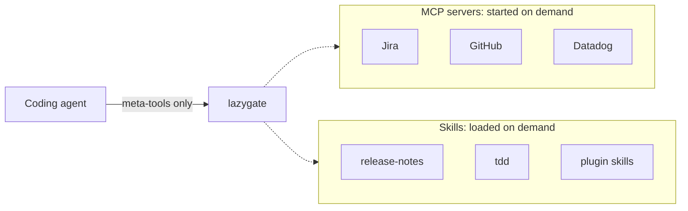

<div align="center">

# lazygate

**Your agent doesn't need every tool schema and every skill playbook to say hello.**

lazygate loads MCP servers **and** agent skills *only when the task needs them*.<br>
Works with Claude Code, Cursor, and OpenCode.

[Quick start](#quick-start) · [How it works](#how-it-works) · [Team gateway](#team-gateway) · [Docs](#docs)

</div>

---

## The problem

Two things quietly fill your agent's context before you've typed anything:

- **MCP servers.** Each one sends its full tool list to the model on every turn, whether you use it or not. Connect Jira, GitHub, Datadog and a few others, and you're carrying thousands of tokens of schemas.
- **Skills.** Every skill and plugin you install adds more text to each session. The more playbooks you collect, the less room is left for the actual work.

lazygate puts both behind a small set of meta-tools. The agent finds and starts a server, or finds and loads a skill, only when the task calls for it.

Measure it on your own catalog (MCP servers **and** skills):

```bash
npm run build
lazygate benchmark --estimate                         # free local preview
lazygate benchmark --runner codex --model gpt-6-luna  # skills (+ MCP attempt)
lazygate benchmark                                    # Claude: best for MCP schemas
```

On one Codex/`gpt-6-luna` run against a 40-skill catalog:

| Strategy | Input tokens |
|---|---:|
| All skill bodies in context | 81,865 |
| **Stubs only (lazygate)** | **21,244** |
| Stubs + largest skill loaded | 28,415 |

That's about **74% fewer idle tokens** for skills (−60,621 / request). MCP schema cost shows up more clearly with `--runner claude` (Codex keeps a large fixed system prompt and does not surface tool schemas the same way). Details: [Benchmark](docs/reference.md#benchmark).

## Quick start

lazygate isn't on npm yet. Build it from source (Node.js 20 or later):

```bash
git clone https://github.com/micaelmalta/lazygate.git
cd lazygate
npm install && npm run build
npm link          # puts `lazygate` on your PATH
```

Then move your existing servers and skills behind it:

```bash
lazygate migrate --from claude --dry-run   # preview
lazygate migrate --from claude             # servers, skills and plugins
lazygate migrate --from cursor             # or: opencode (servers)
```

From Claude Code, `migrate` picks up your MCP servers, the skills in `~/.claude/skills`, and plugin skills. Skills stay where they are; nothing is moved.

Restart your client and ask it to *"list active servers"* or *"find a skill for writing release notes"*. Changed your mind? Run `lazygate revert --from claude`. Every file lazygate touches is backed up first.

## How it works



### Servers

```
You:    Find open GitHub issues labelled "bug"
Agent:  discover_tools("github issues")   → github looks like the right server
        activate_server("github")         → starts it
        describe_tool("github", "search_issues")
                                          → fetches just this one schema
        call_tool("github", "search_issues", { … })
```

### Skills

```
You:    Write release notes for v2.3
Agent:  discover_skill("release notes")   → release-notes matches
        load_skill("release-notes")       → pulls in the full instructions
        read_skill_file("release-notes", "template.md")
                                          → reads a bundled file, if the skill has one
```

Until a skill is loaded, the session only carries its name, description and a one-line pointer. lazygate does this by splitting each `SKILL.md` in two: the frontmatter stays in `SKILL.md`, and the body moves to `INSTRUCTIONS.md`, which `load_skill` returns. `revert` merges them back into the original file, and a `SessionStart` hook redoes the split when plugins update.

### Meta-tools

The agent sees these instead of every server's tools and every skill's body:

| Tool | What it does |
|---|---|
| `discover_tools` | Find the right server for a task |
| `activate_server` / `deactivate_server` | Start or stop a server |
| `describe_tool` / `call_tool` | Fetch one schema, call a tool |
| `list_active_servers` | Show what's running in this session |
| `discover_skill` | Find the right skill for a task |
| `load_skill` | Load a skill's full instructions |
| `read_skill_file` | Read a file bundled with a skill (templates, scripts, references) |
| `connect_server` / `disconnect_server` | Gateway only: attach or remove credentials |

<details>
<summary>Why activated tools don't show up in <code>tools/list</code></summary>

By default (`expose: "none"`), activated servers stay out of `tools/list`, and the agent reaches them through `describe_tool` / `call_tool`. Two reasons:

- Many clients ignore `notifications/tools/list_changed`, so newly added tools would never appear anyway.
- Changing `tools/list` mid-session invalidates the prompt cache for everything after the tools block.

You can opt in per server with `expose: "all"` or an allowlist of tool names in `servers.json`. See [Routing](docs/reference.md#routing).

</details>

## What you get

- **Lean context.** Only meta-tools are loaded until a server or skill is actually needed.
- **A skill library that scales.** Install as many skills as you like; each one costs a line until it's loaded.
- **One-command migration.** Imports servers from Claude Code, Cursor or OpenCode, plus skills and plugin skills from Claude Code, and reverts cleanly.
- **Secrets out of client JSON.** Secrets move to your shell environment, `${secret:…}` templates, or a per-user encrypted vault.
- **Live config.** Edits to `servers.json` and `skills.json` apply without a restart.
- **Stdio and HTTP servers,** including OAuth (PKCE) for remote MCP servers.

## Team gateway

Run one shared lazygate for a whole team instead of every developer maintaining their own collection of MCP servers and skills.

```bash
lazygate token create --user you --admin
lazygate serve
# MCP → http://127.0.0.1:8787/mcp
# UI  → http://127.0.0.1:8787/ui
```

Open `/ui`, paste your token, **Install** the servers and skills you want, and **Connect** your credentials. Each user gets their own session, personal access token and encrypted credential vault. Admins curate the shared catalog of servers and skills.

The gateway speaks plain HTTP, so put a TLS reverse proxy in front of it and pass `--allow-remote` for anything beyond localhost. Full guide: [docs/gateway.md](docs/gateway.md).

## Manual setup

If you'd rather not migrate, point your client at lazygate directly:

```bash
claude mcp add --scope user lazygate -- lazygate
```

Or in `~/.claude.json` / Cursor's `mcp.json`:

```json
{
  "mcpServers": {
    "lazygate": { "command": "lazygate" }
  }
}
```

Without `npm link`, use `"command": "node", "args": ["/path/to/lazygate/dist/index.js"]`. Keep the name `lazygate` so a later `migrate` doesn't add a second entry.

Servers live in `~/.config/lazygate/servers.json` and skills in `~/.config/lazygate/skills.json`. Registering a skill by hand is one entry pointing at its `SKILL.md`:

```json
{
  "skills": {
    "release-notes": {
      "description": "Write release notes from merged PRs",
      "keywords": ["release", "changelog", "notes"],
      "path": "/path/to/skills/release-notes/SKILL.md"
    }
  }
}
```

For both servers and skills, `description` and `keywords` drive discovery. See [Configuration](docs/reference.md#configuration) and [Skills](docs/reference.md#skills) for every field.

## Docs

| | |
|---|---|
| [Gateway guide](docs/gateway.md) | HTTP gateway, web UI, tokens, vault, TLS |
| [Reference](docs/reference.md) | Server and skill configuration, routing, migration, benchmark |
| [Upgrading from context-broker](docs/reference.md#upgrading-from-context-broker) | The old name still works; installs upgrade in place |
| [CLAUDE.md](CLAUDE.md) | Architecture notes for contributors |

## Development

```bash
npm run build && npm test
npm run dev          # run from source, no build step
npm run benchmark    # MCP + skills token savings (needs `claude` on PATH)
```
