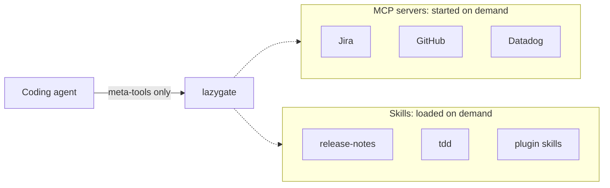

# How lazygate works

The technical companion to the [README](../README.md). It covers the architecture, the meta-tools
the agent sees, how skills are split, tool chain, manual setup, and development. For every config
field, see the [reference](reference.md). For the shared HTTP gateway, see the [gateway guide](gateway.md).

## Architecture

lazygate is an MCP server that acts as a proxy. The client connects to lazygate only. lazygate
advertises a small, fixed set of meta-tools and starts real MCP servers or loads skills when the
agent asks for them.



It runs in two modes:

- **Stdio** (default): one lazygate per client, configured from `~/.config/lazygate/`.
- **HTTP gateway** (`lazygate serve`): one shared lazygate for a team, with per-user sessions,
  tokens, an encrypted credential vault, and a web UI. See [gateway.md](gateway.md).

Both stdio MCP servers and HTTP MCP servers (including OAuth with PKCE) can sit behind it.

## Meta-tools

The agent sees these instead of every server's tools and every skill's body:

| Tool | What it does |
|---|---|
| `discover_tools` | Find the right server for a task |
| `activate_server` / `deactivate_server` | Start or stop a server |
| `describe_tool` | Fetch one tool's schema, or TypeScript stubs for a server's tool-chain tools |
| `call_tool` | Call one tool on a server |
| `run_chain` | Run a short script that chains opted-in tools; only its logs and return value come back |
| `list_active_servers` | Show what's running in this session |
| `discover_skill` | Find the right skill for a task |
| `load_skill` | Load a skill's full instructions |
| `read_skill_file` | Read a file bundled with a skill (templates, scripts, references) |
| `connect_server` / `disconnect_server` | Gateway only: attach or remove credentials |

Ten are listed in stdio mode; the gateway adds `connect_server` / `disconnect_server`.

### Using a server

```
You:    Find open GitHub issues labelled "bug"
Agent:  discover_tools("github issues")   → github looks like the right server
        activate_server("github")         → starts it
        describe_tool("github", "search_issues")
                                          → fetches just this one schema
        call_tool("github", "search_issues", { … })
```

If the agent calls an unknown tool by name, lazygate activates the best-scoring server and retries
the call. Every failure comes back as an `isError` result rather than a crash.

### Using a skill

```
You:    Write release notes for v2.3
Agent:  discover_skill("release notes")   → release-notes matches
        load_skill("release-notes")       → pulls in the full instructions
        read_skill_file("release-notes", "template.md")
                                          → reads a bundled file, if the skill has one
```

## Skill split

Until a skill is loaded, the session only carries its name, description and a one-line pointer.
lazygate does this by splitting each `SKILL.md` in two:

- `SKILL.md` keeps the frontmatter and a one-line `<!-- lazygate: … -->` pointer. This is what the
  client injects into every session.
- `INSTRUCTIONS.md` holds the body, which `load_skill` returns on demand.

A `SessionStart` hook redoes the split when plugins update. `lazygate revert` merges the two files
back into the original `SKILL.md`.

## Why activated tools stay out of `tools/list`

By default (`expose: "none"`), activated servers stay out of `tools/list`, and the agent reaches
them through `describe_tool` / `call_tool`. Two reasons:

- Many clients ignore `notifications/tools/list_changed`, so newly added tools would never appear.
- Changing `tools/list` mid-session invalidates the prompt cache for everything after the tools
  block.

You can opt in per server with `expose: "all"` or an allowlist of tool names in `servers.json`. See
[Routing](reference.md#routing).

## Tool chain

`run_chain` is for multi-step work: list, filter, then fetch details. The agent writes one short
JavaScript body; the script calls opted-in tools as `servers.<name>.<tool>(args)`. Intermediate
results stay inside the script, and only what it logs or returns reaches the model.

```js
const issues = await servers.jira.search({ jql: "assignee = currentUser() AND status = Open" });
const stale = issues.issues.filter((i) => i.fields.updated < "2026-10-01");
return stale.map((i) => ({ key: i.key, summary: i.fields.summary }));
```

- **Opt-in per server.** Set `toolChain: true` or an allowlist of tool names in `servers.json`, or
  pick "all tools" / "allowlist" in the gateway UI. Servers without it are not callable from scripts.
- **Sandboxed.** Scripts run in QuickJS compiled to WebAssembly, with no network, filesystem,
  `require` or `fetch`. Memory, time, call count, concurrency and output size are all capped.
- **Same checks as `call_tool`.** Every nested call goes through visibility, allowlist and lazy
  activation. The gateway audits each one with `via: "run_chain"` and redacts credentials.
- **Keep `call_tool` for single or destructive calls,** so the client approves each one on its own.

Limits and the full security model: [Tool chain](reference.md#tool-chain).

## Manual setup

If you'd rather not run `migrate`, point your client at lazygate directly:

```bash
claude mcp add --scope user lazygate -- lazygate
```

Or in `~/.claude.json` / Cursor's `mcp.json`:

```json
{
  "mcpServers": {
    "lazygate": { "command": "lazygate" }
  }
}
```

Without `npm link`, use `"command": "node", "args": ["/path/to/lazygate/dist/index.js"]`. Keep the
name `lazygate` so a later `migrate` doesn't add a second entry.

Servers live in `~/.config/lazygate/servers.json` and skills in `~/.config/lazygate/skills.json`.
Edits apply without a restart. Registering a skill by hand is one entry pointing at its `SKILL.md`:

```json
{
  "skills": {
    "release-notes": {
      "description": "Write release notes from merged PRs",
      "keywords": ["release", "changelog", "notes"],
      "path": "/path/to/skills/release-notes/SKILL.md"
    }
  }
}
```

For both servers and skills, `description` and `keywords` drive discovery. See
[Configuration](reference.md#configuration) and [Skills](reference.md#skills) for every field.

## Migration

`lazygate migrate --from claude|cursor|opencode` reads your client's MCP servers, converts them to
lazygate entries, moves secrets out of client JSON into your shell environment, registers skills in
place (no files are moved), and registers lazygate in the client. Every file it changes is backed up
first and written atomically. `lazygate revert` restores each client's own format. Details:
[Migration](reference.md#migration).

## Benchmark

```bash
npm run build
lazygate benchmark --estimate                         # free local preview, no model calls
lazygate benchmark                                    # Claude: MCP schemas and skills
lazygate benchmark --runner codex --model gpt-6-luna  # skills on Codex
lazygate benchmark --tasks                            # multi-step task: direct, call_tool, call_tool+opt, run_chain
```

`--tasks` runs one fixture job (`src/__tests__/fixtures/tickets-server.mjs`: count ana's open
tickets and sum each ticket's `bodyLength`, expected `8 60000`) four ways and only reports token
deltas between strategies that both answered correctly:

| Strategy | What the model sees | Input tokens (range) | Turns | Time |
|---|---|---:|---:|---:|
| `direct` | Every runnable server in `servers.json` plus the fixture, connected straight to Claude (16 servers; OAuth-only ones skipped) | 537,456 (479,132–654,070) | 10.3 | 6.2 s |
| `call_tool` | lazygate meta-tools; one `get_ticket` result per turn | 225,877 (225,853–225,892) | 10 | 5.8 s |
| `run_chain` | lazygate meta-tools; one script fetches and sums every ticket | 206,200 (206,194–206,203) | 3 | 5.0 s |

`lazygate benchmark --tasks --rounds 3` with the Claude runner; means over 3 cold runs per strategy,
all 9 correct. That works out to −58.0% for `call_tool` and −61.6% for `run_chain` against `direct`,
and −8.7% for `run_chain` against `call_tool`. `direct` is also the noisy one: one of its runs took an
extra turn (mean 10.3), and every extra turn re-sends all 16 servers' schemas, which likely explains
the 654,070 outlier.

The table predates a fourth strategy, `call_tool+opt`: `call_tool` with response optimization on
(`defaultMode: "adaptive"`, no per-tool policy) and the model passing `fields` for `get_ticket`.
It is the end-to-end check for response optimization: the answer must still be correct, and its
delta against `call_tool` is what optimization saved across the whole task. A fixture-only run
(`lazygate benchmark --tasks --rounds 3`, no `--include-catalog`, so `direct` carries just the
tickets server):

| Strategy | Input tokens (range) | Turns | Time |
|---|---:|---:|---:|
| `direct` | 223,270 (223,261–223,287) | 10 | 6.2 s |
| `call_tool` | 228,085 (228,065–228,105) | 10 | 6.0 s |
| `call_tool+opt` | 210,774 (210,730–210,812) | 10 | 6.2 s |
| `run_chain` | 208,408 (208,384–208,429) | 3 | 4.4 s |

All 12 runs were correct. Optimization saved 7.6% against `call_tool` with no extra turns and no
`get_result` follow-ups, since the requested fields were all the task needed. With a single small
server, `call_tool` costs 2.2% more than `direct` (the meta-tool schemas outweigh one server's
tools); the schema savings in the table above appear only once there are many servers.

The same command with `--include-catalog` (`direct` carries 15 runnable catalog servers plus the
fixture):

| Strategy | Input tokens (range) | Turns | Time | Correct |
|---|---:|---:|---:|---:|
| `direct` | 480,536 (480,524–480,548) | 10 | 5.9 s | 2/3 |
| `call_tool` | 228,202 (228,182–228,239) | 10 | 6.1 s | 3/3 |
| `call_tool+opt` | 216,728 (210,901–228,343) | 10 | 6.3 s | 3/3 |
| `run_chain` | 208,546 (208,533–208,570) | 3 | 4.1 s | 3/3 |

Against `direct` that is −52.5% for `call_tool`, −54.9% for `call_tool+opt` and −56.6% for
`run_chain`; the schema savings only appear with the full catalog. Two things to read carefully:

- **`call_tool+opt` varied.** Its mean saves 5.0% against `call_tool`, but its range is wide:
  one run cost 228,343 tokens, the same as plain `call_tool`, so optimization saved nothing that
  round (most likely the model did not pass `fields`), while the other runs saved about 7.6%.
  Savings from `fields` depend on the agent asking for them.
- **Optimization saves tokens here, not time.** `call_tool+opt` took 6.3 s against 6.1 s for
  `call_tool`, with the same 10 turns. The one strategy that is clearly faster is `run_chain`
  (3 turns, 4.1 s against 5.9 s for `direct`), because it removes agent turns. Times are means
  of three runs, without a spread, so small differences are noise.
- **`direct` got one answer wrong** (2/3 correct), and its mean covers the correct runs only. With
  three rounds that is an observation, not a measured error rate.

Both runs use one fixture task and three rounds, so they show the shape of the savings, not a
general performance claim.

Each run is a single cold-cache turn, so cost figures overstate steady-state savings. Codex keeps a
large fixed system prompt and does not surface tool schemas the same way, so MCP savings show up
more clearly with the Claude runner. What each strategy measures: [Benchmark](reference.md#benchmark).

## Development

```bash
npm run build && npm test
npm run dev          # run from source, no build step
npm run benchmark    # MCP + skills token savings (needs `claude` on PATH)
```

Architecture notes for contributors, including the source file map: [CLAUDE.md](../CLAUDE.md).
